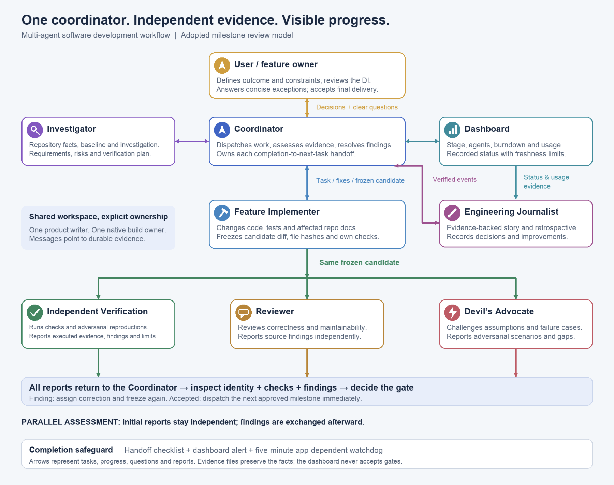

# Choose the work. Make acceptance evidence-based.

## One toolbox, three entry points

Repair a defect, change an existing product or discover a new one. Use a shared contract for scope, authority, evidence and handoffs, with assurance proportionate to the consequences.

[Choose a workflow](quick-start.md){ .md-button } [Read the specification](toolbox.md){ .md-button } [See worked examples](worked-examples.md){ .md-button }

The toolbox builds on an existing multi-agent feature practice and its retrospectives. The three new entry points are pilot contracts; they do not introduce an autonomous orchestration service. Start with the [shared work contract](downloads/work-contract.txt) plus one kickoff.

The approved [AOS investigation and Concept Approval package](aos-concept.md) defines a shared local core and bug-fix runner operated through ChatGPT macOS. The [M0 prototype](aos-concept.md#m0-prototype-and-qualification-result) is implemented. Chat record access and bounded runtime interruption/command cleanup are demonstrated; human confirmation remains unqualified. New projects show their structure/team before investigation and require explicit Concept Approval before implementation.

## Select the purpose and assurance

| Workflow | Question | First useful evidence |
| --- | --- | --- |
| Bug fix | Why does intended behavior fail? | Minimal reproduction and demonstrated correction |
| Feature change | How should an existing capability change? | Integrated user journey on the accepted product baseline |
| New product | Is this useful and feasible? | Bounded feasibility result, then a first usable slice |

Lightweight, standard and elevated assurance apply independently of work type. A small patch can have large consequences. Publication, a dashboard, recurring monitoring and a separate Journalist are explicit project choices. Read the [selection rules and shared core](toolbox.md).

## Extended feature practice

The original full-package recipe remains available with its DI, independent assessment trio, specification/checkpoints, dashboard, recurring audits, Confluence outputs and retrospective/actions obligations. Selecting it is explicit. Existing running projects retain their agreed contracts.

[Start the extended recipe](extended-feature-start.md), [explore its roles](roles.md), or [download the original workflow PDF](assets/coordinated-multi-agent-workflow.pdf). The figure describes that recipe rather than a required crew for every toolbox task.

## Extended recipe artifacts

| Artifact | Use it for |
| --- | --- |
| Kickoff prompt | Define scope, authority, roles, approval gates and delivery |
| DI template | Present observed behavior, choices, ordered stages and acceptance evidence |
| Assignment and gate templates | Name one owner, exact candidate, shared resources, independent reports and acknowledged next action |
| Example state and checker | Demonstrate a bounded, machine-checkable handoff record |
| Live dashboard and workflow state | Serve a reusable display with current stage, next action, all pending approvals and responsive burndown |
| Five-minute watchdog | Audit completions and dispatch authorized handoffs quietly between active turns |
| Generated product specification | Required Implementer output, independently checked against requirements and behavior |
| Intermediate commits | Scoped authorized rollback points with Verification tree receipts before dependent work |
| Confluence outputs | Review the published DI before implementation; capture lessons as its child page |
| Retrospective template | Collect actual independent reflections, real exchanges and a checked record |
| Post-retrospective actions milestone | Execute authorized findings and track deferred experiments before workflow closure |

## The central rule

**An agent finishing an assignment creates a coordinator obligation.** Read its report, check the source identity and executed evidence, record the gate disposition, release resources and dispatch the next authorized owner. Record that the assignment was acknowledged or expose a precise dependency.

Agent activity is not delivered progress. Test count is not requirement coverage. An accepted local candidate is not an installed or released product.

The [lessons](lessons.md) explain what the completed implementation and retrospective added. Templates use configurable roles and native project commands rather than project-specific defaults. [Publication boundaries](reference.md) describe the explicitly approved PDF reference and how other company-source material stays outside the kit.

!!! note "A workflow kit, not a service"
    These files do not launch agents, monitor a session or enforce the truth of reports by themselves. The current checker covers the extended gate format only. The coordinator and available runtime tools carry out the contracts.
